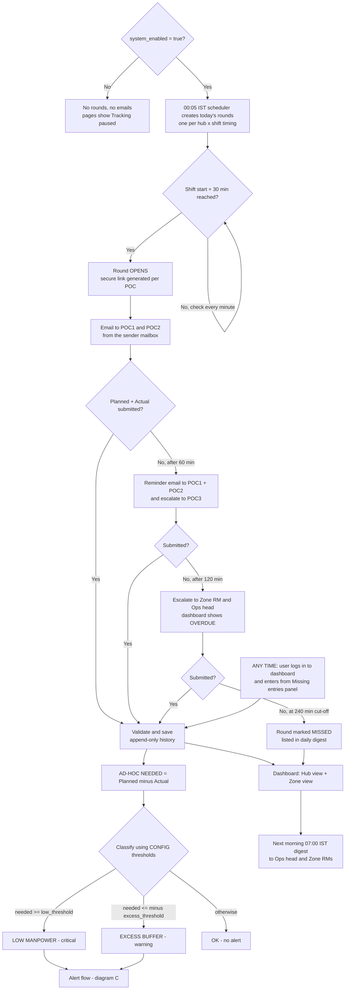
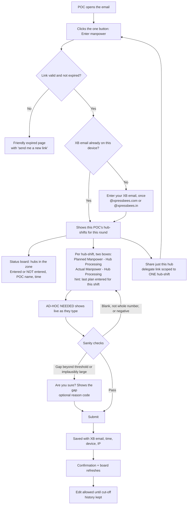
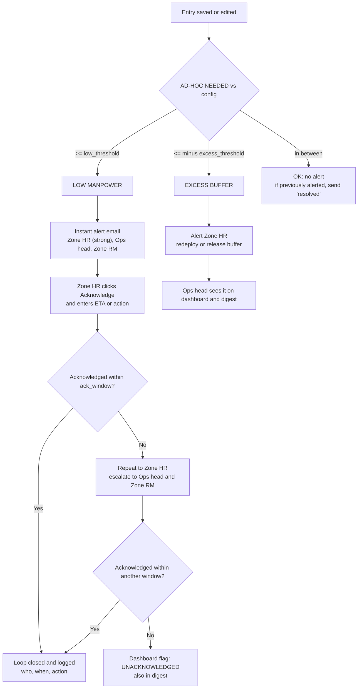
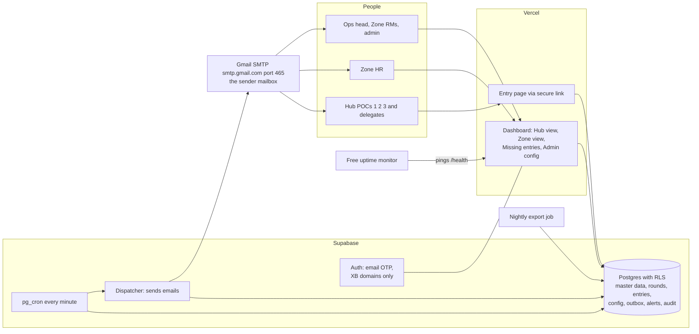

# Peak Shift Manpower Tracker: System Design (v1, email only)

## Context

During peak season each hub runs 1 to 9 shifts a day. Ops has no closed-loop way to know, within 30 minutes of a shift starting, whether that shift is short or over-staffed, and nobody is accountable for reporting it. The system will, for every hub x shift timing x day:

1. **Email** the hub POCs at **shift start + 30 min**, from the sender mailbox (a **Gmail** mailbox, sent through Google's own servers; see 5.2 #4).
2. Collect **Planned Manpower - Hub Processing** and **Actual Manpower - Hub Processing** from the POC through a one-tap link. The link needs no login, asks only for the XB email, and can be forwarded to a shift in-charge.
3. Calculate **AD-HOC MANPOWER NEEDED = Planned - Actual** and alert HR and Ops when it crosses config thresholds (default 10).
4. Show who has entered and who has not (with POC name) on the entry page and on a **Hub-level and Zone-level dashboard**.
5. Remind after 1 hour and escalate to POC3 if nothing is entered. Anyone can also log in to the dashboard and enter missing numbers at any time.

**WhatsApp is out of scope for v1 and comes in v2. SMS is dropped.**

**What I do first after you approve:** build the Excel input template you asked for (section 4). Then the design docs. The application build follows once your data is in.

Stack: **Vercel** (frontend), **Supabase** (Postgres, Auth, RLS, pg_cron), **Git**, all on free tiers. The project folder is empty, so nothing existing is reused.

## 1. The system's rules

### 1a. Core rules

| Item | Rule |
|---|---|
| Hub-shift | A hub plus its shift timing (`start-end`, e.g. `08:00-16:00`). No shift codes. |
| Round | One per hub x shift timing x date. It opens at `shift_start + 30 min` (config). |
| Planned / Actual | Both entered by the POC. Both are whole-number "Hub Processing" headcount. |
| **AD-HOC MANPOWER NEEDED** | `Planned - Actual`. Positive means short, and negative means excess. |
| Classification (management rule, 2026-10-10) | **LOW (ad-hoc manpower needed)** when Actual is **10% or more below** Planned, i.e. Gap % = (Planned - Actual) / Planned >= 10%. **EXCESS** when Actual is 10% or more above Planned. Otherwise **OK**. Boundaries are inclusive. The 10% is a setting (`low_pct`, `excess_pct`); a fixed headcount mode (`threshold_mode = absolute`) is still available, and either can be overridden per hub. |
| First email goes to | **POC1 and POC2**. Either can submit and the first submission wins. POC3 joins on escalation. |
| Escalation (T0 = round opens) | T0: POC1+POC2. **T0+60**: reminder to POC1+POC2 and escalate to POC3. T0+120: Zone RM and Ops head. T0+240: MISSED. All offsets are config. |
| LOW alert | Instant email to **Zone HR (strong), Ops head and Zone RM**. Zone HR must tap **Acknowledge** with an ETA or action. If not acknowledged in 30 min, repeat to Zone HR and escalate to Ops head. (Hub HR is not collected, so alerts go to the hub's Zone HR.) |
| EXCESS | **Not emailed to anyone** (management decision). It is shown on the dashboard (EXCESS chip, tiles, chart), on the Alerts page ("shown only, no email sent") and in the daily digest, and the entry form tells the person it is not sent to HR. Controlled by `alert_recipients_excess` (empty). |
| **Morning report to POC3 (regional managers)** | Every day at **06:00 IST**, each POC3 receives one email about **yesterday** for all hubs under them: the shifts ranked by Gap % against plan, largest first, with the **LOW (ad-hoc) shifts highlighted in red**, plus counts of LOW shifts, people short and shifts with no entry. Sent once a day; if the system was off at 06:00 it goes out when it is back on. Settings: `poc3_report_enabled`, `poc3_report_time_ist`. |
| Same person in several POC slots | Allowed (e.g. a placeholder during testing). The person gets **one** email per round, not one per slot, and escalation to POC3 adds no extra email if POC3 is the same person. |
| Edits | Allowed until cut-off, with full history. Entry after cut-off is accepted and flagged "late". |

### 1b. Config (Admin Settings screen, no code change)

A `app_config` key-value table holds global defaults, and a `config_override` table holds optional per-hub overrides. Every change is logged (who, when, old and new value) and applies to rounds that open **after** the change.

| Key | Default |
|---|---|
| `system_enabled` | true (the master switch, see 1d) |
| `threshold_mode` | `percent` (alternative: `absolute` headcount) |
| `low_pct` / `excess_pct` | 10 / 10 (% of planned) |
| `low_threshold` / `excess_threshold` | 10 / 10 (headcount; used in absolute mode, or when nothing was planned) |
| `round_open_offset_min` | 30 |
| `reminder_offset_min` / `l3_escalation_offset_min` | 60 / 60 |
| `zone_rm_ops_escalation_offset_min` | 120 |
| `cutoff_offset_min` | 240 |
| `ack_required_low` / `ack_window_min` | true / 30 |
| `alert_recipients_low` / `alert_recipients_excess` | LOW: Zone HR, Ops head, Zone RM. EXCESS: nobody (empty). |
| `poc3_report_enabled` / `poc3_report_time_ist` | true / 06:00 |
| `status_board_scope` | `zone` (alternatives: `all`, `own`) |
| `digest_time_ist` | 07:00 |
| `allowed_email_domains` | `xpressbees.com`, `xpressbees.in` |
| `sender_email` / `sender_display_name` | the sender mailbox / "XB Peak Shift Tracker" (swappable later) |
| `daily_send_cap` / `cap_warn_pct` | 1,500 / 80 (the admin is emailed at 80% of the cap, and low-priority mails such as reminders are held at 100%, but LOW alerts always go) |
| `reply_to` | blank, or a shared inbox (emails also say "Do not reply") |
| `sanity_max_headcount` | upper bound for the "are you sure?" prompt |

### 1c. Dashboard

- **Hub view.** One row per hub x shift for the selected date. Columns: Hub, Zone, Shift timing, POC, **Planned - Hub Processing**, **Actual - Hub Processing**, **AD-HOC MANPOWER NEEDED**, class chip (LOW / EXCESS / OK), entry status (Entered by <email> at <time> / Pending / Overdue / Missed / Late), email delivery status.
- **Zone view.** One row per Zone. Columns: Planned total, Actual total, Ad-hoc needed (net), **Shortfall-only total**, **Excess-only total**, hubs entered / total, compliance %, count of LOW hubs. Net alone would let one hub's excess hide another's shortfall. Drill down from zone to hubs.
- **Charts.** Diverging bar of ad-hoc needed per hub with the threshold band, a zone bar chart, a per-hub trend, and a hub x day heatmap.
- **Missing entries panel.** Every round past its open time with no data, with an inline form for planned and actual.
- **Alerts feed** with acknowledgement status, a date/zone filter, and **Export to CSV/Excel**.
- **Login:** email OTP, restricted to the allowed domains. Any logged-in XB user can view and enter, and every entry is attributed.

### 1d. The on/off switch (your question: "guide me about this")

There are no peak dates. The system simply runs every day while it is ON. Four levels, from gentlest to hardest:

| Level | How | Effect |
|---|---|---|
| 1. Master switch | Admin Settings toggle for `system_enabled`, or SQL: `update app_config set value='false' where key='system_enabled';` | The scheduler still ticks but creates no new rounds and sends **no emails**. Entry pages show "Tracking is paused". All data is kept. Turning it back on resumes from the next round, with **no backfill** of missed rounds (config `backfill_on_resume=false`). |
| 2. Per hub | Set `Active = N` for the hub in the `Hubs` sheet, or in the app | That hub is excluded and everything else keeps running. |
| 3. Hard stop | In Supabase, unschedule the pg_cron job (one SQL line, which I will document) | Nothing runs at all. Used only in an emergency. |
| 4. Frontend only | Redeploy Vercel with an env var `MAINTENANCE_MODE=true` | Pages show a maintenance message, but the scheduler keeps running. |

Recommended: use level 1 for the "off-season" and level 2 for single hubs.

### 1e. POC Directory (view and change POCs at any time)

Right now many hubs carry a placeholder (one person in POC1/2/3), and real POCs will replace it over time. So POC changes are a first-class admin feature, not a re-upload chore. It is one page in the dashboard, visible to SYSTEM_ADMIN only.

| Feature | Behaviour |
|---|---|
| **Directory view** | One row per hub: Hub, Zone, POC1, POC2, POC3 (name + email), Active, and a **Placeholder** badge wherever the person is the placeholder. Filters by Zone, search by hub or person, and a "Show placeholders only" toggle so you can see what is still to be assigned. |
| **Edit in place** | Click a POC cell, type name + XB email, save. The email is validated against `allowed_email_domains`. |
| **Replace a person everywhere** | "Replace [person] with [person] on [selected hubs / all hubs / one zone]". This is the fast path for moving off the placeholder. |
| **Bulk assign** | Select many hubs and set POC1/2/3 in one go. |
| **Excel round trip** | "Download directory" gives the same `Hubs` sheet layout. After editing, "Upload" updates by Hub name only (no duplicates). A preview shows exactly what changes before you confirm. |
| **Zone contacts** | The same page has a Zones tab for Zone RM and Zone HR, and a Global Contacts tab. |
| **When it takes effect** | Immediately for rounds that open **after** the change. A round already open keeps the people who were emailed, so nobody who got a link loses access mid-round. |
| **Audit trail** | Every change is logged: who, when, hub, slot, old person, new person. A "recent changes" panel is on the page. |
| **Safety** | A change that would leave a slot blank, or use an email outside the allowed domains, is refused. If one person fills several slots, the system sends them one email per round, not one per slot. |

Until the app exists, the same job is done by editing the `Hubs` sheet of the Excel and re-sending it.

---

## 2. Flowcharts

### A. Daily lifecycle

### B. What the POC experiences on the link

### C. Alert and escalation logic

Dedupe rule: an edit that stays in the same class sends no duplicate. An edit that changes the class sends an "updated" email.

### D. Architecture

The scheduler lives in **Supabase**, not Vercel cron, so a frontend deploy can never stop the 08:30 emails.

### E. Worked timeline: 08:00 shift (defaults)

| Clock | Event |
|---|---|
| 08:00 | Shift starts |
| 08:30 | Round opens. POC1+POC2 get the email. |
| 09:30 | No entry: reminder to POC1+POC2 and escalation to POC3. |
| 10:30 | No entry: Zone RM and Ops head are informed. OVERDUE. |
| 12:30 | Cut-off. MISSED goes into tomorrow's digest. Entry is still accepted and flagged "late". |

### Email design ("well structured, no fluff, visually intuitive")

Every email has **one purpose and one button**. They use HTML with inline CSS and a plain-text fallback, are mobile-first, and look right in light and dark mode.

| Email | Subject pattern | Body (top to bottom) |
|---|---|---|
| Round open | `ACTION: Enter manpower - {Hub} {08:00-16:00}` | Coloured header band with Hub, shift and **due time**. One small table of the hub-shifts. One big button **Enter manpower**. One line: "Takes 30 seconds. Forward this to your shift in-charge if needed." |
| Reminder | `REMINDER (60 min): {Hub} {shift} not entered` | Amber band, "still pending since {time}", the same button. |
| Escalation | `ESCALATION: {Hub} {shift} has no manpower entry` | Red band, who was notified and when, the same button. |
| LOW alert | `LOW MANPOWER: {Hub} {shift} short by {N}` | Red band. A three-number strip: **Planned / Actual / Short by**. Button **Acknowledge and give ETA**. |
| EXCESS alert (switched off) | `EXCESS MANPOWER: {Hub} {shift} +{N} above plan` | Not sent by default. The template exists only in case management later adds recipients in `alert_recipients_excess`. |
| POC3 morning report | `Yesterday's manpower report {date}: {N} shifts needed ad-hoc manpower` | Red or green band, a three-number strip (LOW shifts / people short / no entry), then one table ranked by Gap %, LOW rows shaded red, EXCESS rows blue, no-entry rows last. |
| Daily digest | `Daily manpower digest - {date}` | One compact table per zone: missed rounds, LOW and EXCESS hubs, unacknowledged alerts. |

---

## 3. Reliability and trust design (free-tier friendly)

- **One source of truth.** The database is the only record. Entries, edits, alerts, acks and config changes are append-only and timestamped.
- **Idempotent scheduler.** The outbox has a unique key (round, recipient, step), so retries never double-send.
- **Retry and failover.** Failed sends retry with backoff. If a person's email hard-bounces, the next level is escalated immediately and the admin is alerted.
- **Delivery visibility.** Sent, bounced and opened status shows on the dashboard where the mail platform supports it. This ends "I never got it".
- **Watchdog.** A heartbeat row is written every minute, and a free external monitor pings `/health`. A stale heartbeat of more than 3 minutes emails the admin. The same ping keeps the Supabase free project from pausing from inactivity.
- **Link security.**
  - Tokens are 128-bit random and only the hash is stored.
  - Each token is scoped to a POC and round, or to one hub-shift for delegate links, and it expires after cut-off plus a grace period.
  - Requests are rate-limited.
  - The XB email is self-declared on the link, as requested. It is validated for the domain and logged on every entry.
- **Closed system.** Dashboard login is email OTP restricted to the allowed domains, with no public sign-up. Admin Settings is limited to SYSTEM_ADMIN.
- **Go-live readiness gate.** A hub cannot be activated until its row is complete and a test email has reached every person on it.
- **Dry-run mode.** All emails are routed to the admin only, for pilot and testing.
- **Time.** Stored in UTC, computed in IST. Overnight shifts are supported, and the round date is the shift's start date.
- **Backups (free).** A nightly scheduled export of all tables to CSV, stored in a company-controlled location. The volume is tiny, so the free tiers are ample.

### Hardening added after the end-to-end review

- **Email delivery policy** (per email kind). LOW alerts keep retrying for 24 h (more than 20 attempts, so a ~30 min Gmail outage is survived). "Please enter" reminders and L3 escalations expire after about 90 min, because a stale reminder is worse than none. Emails whose recipient list is empty in dry-run are held, not sent. The admin can re-queue failed mail (last 24 h) from Admin > Emails.
- **Alert state machine.** One open alert per round (unique partial index). A class change sends an "updated" or "resolved" email; flapping is capped at 4 changes per 6 h. EXCESS is shown in the UI only and is never emailed.
- **Round creation grace.** A hub-shift whose round time passed up to `round_create_grace_min` (default 60) ago is still created, so a short outage at midnight does not lose rounds.
- **Health.** `/health` reports the last heartbeat (`enabled`, `dryRun`, error count, duration). The heartbeat is written last, so a tick that crashed is never reported healthy.
- **Settings.** `login_known_people_only` (default off) restricts dashboard login to people already in the directory. Every setting is validated on the server with the same rules as the form.
- **Input safety.** Emails are checked as plain mailboxes on the allowed domains (the +tag is ignored for login rate limits). Pasted decimals or signs in number boxes never become a bigger number. Impossible dates in a URL fall back to today. Rate limit: 20 entries per round per hour.
- **Security headers.** CSP, Permissions-Policy, frame and referrer protections on every page.
- **Data hygiene.** `0002_hardening.sql` adds indexes and a daily `cleanup_old_data()` job at 02:30 IST (pg_cron) that removes only throw-away data: emails older than 30 days, expired login codes and links. Entries, rounds, alerts, audit and config history are kept.
- **Import script.** `scripts/import-master.mjs` supports `--check` (validate only), `--prune` (remove hubs/people no longer in the sheet) and `--update-existing`.

---

## 6. Rollout order (gate between each step)

0. Fill the Excel template. In parallel, set up the Gmail app password (Group C), so the first thing I do in the build is a real send test.
1. Data passes the template's checks, then the readiness gate (test email to everyone).
2. Build the core: schema, config tables, scheduler, outbox, entry page, emails.
3. Alerts, acknowledgement loop, dashboard (Hub and Zone views), Missing entries panel, Admin Settings.
4. Dry run on pilot hubs (emails routed to admin only), then live pilot.
5. Phased zone-by-zone rollout, then all hubs.
6. v2: WhatsApp, with mobile columns added to the sheets.

---
